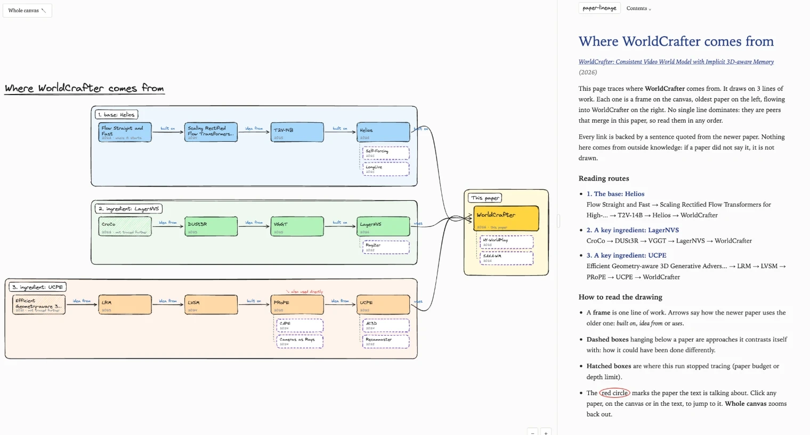

# paper-lineage

**Where does a paper really come from?** Give it an arXiv link. It reads the paper, works out which of
the cited works it *actually descends from*, reads those too, and draws the whole family tree as an
interactive, hand-drawn map, with the sentence from the paper that proves every arrow.

<p align="center">
  
</p>
<p align="center"><sub>Real output for <i>WorldCrafter</i> (2026): three lines of work merge into one paper.
Try it yourself: open <a href="docs/examples/worldcrafter.llm.html"><code>docs/examples/worldcrafter.llm.html</code></a> in a browser.</sub></p>

## Why you might want it

- **Skip the reading list.** Instead of 60 references, you get the 3 to 5 lines of work the paper truly stands on.
- **Lines, not a single chain.** Real papers merge a base model, a technique and key ingredients. You see them as peers, flowing left to right into the paper.
- **Every arrow has a receipt.** Each edge carries the verbatim sentence from the newer paper. The LLM only classifies citations it is shown, never invents papers, and any quote it cannot find in the source text is dropped.
- **"Done differently" branches.** Dashed boxes show the alternatives a paper contrasts itself with.
- **A page you can actually read.** Canvas on the left, walkthrough on the right: scroll the text and the canvas glides to the paper being discussed. One self-contained HTML file, no internet needed to view it.
- **Easy install.** `pipx install` gives you a normal `lineage` command (or use the single-file `lineage.pyz`). Works with any OpenAI-compatible endpoint, and falls back to heuristics with no LLM.

## Quick start

```bash
lineage https://arxiv.org/abs/2609.24984 -f html     # writes lineage-2609.24984.html (the page above)
lineage https://arxiv.org/abs/2609.24984 --evidence  # or print it in the terminal
```

(See [Install](#install) and [Configure the LLM](#configure-the-llm) below.)

## Or in your terminal

```
$ lineage https://arxiv.org/abs/2507.07982 --evidence

Lineage of Geometry Forcing: Marrying Video Diffusion and 3D Representation ... (2025)
No single main path: no dominant line: technique: REPA (…) vs base: DFoT (…); showing lines as peers
Problem context: World Models (2018)

Line 1: technique: REPA
  Denoising Diffusion Autoencoders ... (2023)  [origin]
  │ ↓ idea: diffusion features are discriminative representations
  REPA (2024)
  │ ↓ idea: align diffusion features with a pretrained encoder
  │     “In this work, inspired by recent advances in REPA ( Yu et al., 2024a ), we propose ...”
  Geometry Forcing (2025)

Line 2: base: DFoT
  Diffusion Forcing (2024)
  │ ↓ built on ...
  DFoT (2025)
  ...
Line 3: ingredient: VGGT
  DUSt3R (2023) → VGGT (2025) → Geometry Forcing
Done differently: VideoREPA (2025), World-consistent Video Diffusion with Explicit 3D Modeling (2024)
```
(illustrative; see `docs/examples/` for real output)

## How to read the result

A paper rarely descends from a single chain of papers. It usually stands on several separate lines of
work at once: a technique it borrows, a base model it builds on, an ingredient it plugs in. So the
output is not one path but a graph:

- **Lines flow into your paper.** Each line is a chain of papers, oldest on the left, ending at the
  target. Lines are shown side by side as peers.
- **Main path, only when earned.** One line is highlighted as the main path only if it clearly
  dominates the others (`--spine auto`, the default). Otherwise nothing is singled out.
- **"Done differently" branches.** Each paper can carry up to two alternatives: approaches it
  contrasts itself with.
- **What each paper is.** Every paper gets a one-sentence introduction from its own abstract, shown
  under it in the walkthrough and when you hover its box on the canvas.
- **Names.** The walkthrough gives a paper's full title the first time it comes up, with its short name
  in parentheses (`… (REPA)`), and only the short name after that. The canvas uses the short names.

## Nothing is made up

Every claim is traceable to the text of the papers:

- **Every arrow has evidence.** Each link carries the exact sentence from the newer paper that
  justifies it.
- **The LLM only judges, never invents.** It labels citations it is shown. It cannot add papers.
- **Quotes are checked.** If a quote returned by the LLM cannot be found in the paper's text, that
  link is dropped.
- **Introductions come from the abstract.** Without an LLM, the introduction is the abstract sentence
  where the paper says what it does ("We propose …"), copied word for word. With an LLM, it is a
  one-sentence summary written from the abstract only. The summary is kept only if every number in it
  and nearly all of its words appear in the abstract; otherwise the abstract sentence is shown. A
  paper without an abstract gets no introduction.

## Install

Recommended: install it as a normal command with [pipx](https://pipx.pypa.io) (or [uv](https://docs.astral.sh/uv/)),
which puts `lineage` on your PATH in its own isolated environment:

```bash
pipx install paper-lineage        # or: uv tool install paper-lineage
lineage --help
```

Try it once without installing: `uvx --from paper-lineage lineage --help`.
(Before the first PyPI release, install from git: `pipx install git+https://github.com/legallchaperone/paper-lineage`.)

**No pip at all?** Download the single-file build `lineage.pyz` (everything bundled) and run it with
any `python3` 3.9 or newer: `python3 lineage.pyz --help`. Optionally make it a command:
`chmod +x lineage.pyz && mv lineage.pyz ~/bin/lineage`.
No `python3`? On macOS run `xcode-select --install`; on Windows install Python from python.org.

Optional: `pdftotext` (poppler) for the PDF fallback on papers without arXiv HTML — macOS
`brew install poppler`, Debian/Ubuntu `apt install poppler-utils`.

From source (developers): `pip install -e '.[dev]'`; rebuild the single file with `scripts/build_pyz.sh`.

## Use it from your AI agent

Using Claude Code, Codex, Cursor or another coding agent? Point it at this repo's
[`AGENTS.md`](AGENTS.md) / [`skills/paper-lineage/SKILL.md`](skills/paper-lineage/SKILL.md), or just say
"install paper-lineage and trace the lineage of arxiv.org/abs/..." and it will know what to do.
For Claude Code, copy the skill folder to `~/.claude/skills/paper-lineage/`.

## Configure the LLM

```bash
export LINEAGE_LLM_BASE_URL=http://localhost:3000/v1   # your gateway; /chat/completions is appended
export LINEAGE_LLM_MODEL=<model name your gateway serves>
export LINEAGE_LLM_API_KEY=<key, if the gateway needs one>
lineage --check-llm                         # one tiny request to verify the setup
```

Optional: `S2_API_KEY` (Semantic Scholar key — raises rate limits, makes runs much faster).
Without an LLM configured the tool falls back to `--no-llm` heuristics.

### Or use your ChatGPT subscription (no API key)

With a ChatGPT plan (Plus, Pro, Team, …) the tool can run its LLM calls through OpenAI's official
[Codex CLI](https://github.com/openai/codex), signed in with your ChatGPT account:

```bash
npm i -g @openai/codex
codex login                                 # choose "Sign in with ChatGPT"
lineage --llm codex --check-llm
lineage --llm codex <arxiv url or id> -f html
```

Or set `LINEAGE_LLM_PROVIDER=codex` instead of passing `--llm codex`. Options: `LINEAGE_LLM_MODEL`
(defaults to Codex's own default model), `LINEAGE_CODEX_EFFORT=low` (faster runs),
`LINEAGE_CODEX_BIN` (path to `codex`). Each request runs `codex exec` in an empty temporary folder
with a read-only sandbox. Each call starts a fresh Codex session, so this is slower than an API
endpoint, and the calls count against your plan's usage limits. Replies are cached like API replies.

## Usage

```bash
lineage <arxiv url or id> [options]

  --max-depth N           hard limit on generations traced back (default 4)
  --max-nodes N           max papers read, incl. the target (default 30)
  --parents-per-node K    lineage parents kept per paper (default 4)
  --alternatives K        "done differently" branches per node (default 2; target + 1st generation)
  --min-relevance X       min SPECTER2 similarity to the target (default 0.86) — stops topic drift
  --spine auto|none       highlight a main path only if one line dominates (default auto)
  --descendants N         also show N papers that build on the target (verified from their text)
  --concurrent N          also show N concurrent papers (same time window, cite the same parents)
  -f, --format FMT        tree | mermaid | json | html   (repeatable; default tree)
  -o, --output STEM       output path stem for file formats (default lineage-<id>)
  --evidence              print the evidence sentence under each edge in the tree view
  --no-llm                heuristics only
  --cache-dir DIR         default ~/.cache/paper-lineage (HTTP + LLM replies are cached)
  --full                  tree/mermaid: draw every kept paper, not only the main chains
  --render RUN.json       re-render a saved -f json run (no network, no LLM)
  -v, --verbose           log every keep/drop decision with its reason
```

`-f html` writes a self-contained page in a hand-drawn, Excalidraw-like style (no internet needed to
view it). On the left, a sketchy canvas: each line of work is a titled frame, papers are hand-drawn boxes
and labelled arrows flow left-to-right into your paper, with "done differently" alternatives as dashed
boxes. On the right, a walkthrough with one section per frame and one step per paper: *X is built on Y:
what it inherited*, followed by the sentence quoted from X. Scrolling the text glides the canvas to the
frame and circles the paper being discussed; click a paper on either side to jump to it, drag/pinch to
pan and zoom, **Whole canvas** to zoom out. Formulas in quotes and titles are typeset (MathML), never
shown as raw LaTeX.

The terminal (`tree`) and `mermaid` views show only the main chains by default; add `--full` for
everything. `-f json` keeps the full graph plus the decision log (`decisions`), which is the first
place to look when a result surprises you. Re-render a saved run without fetching anything:

```bash
lineage --render lineage-2609.24984.json -f html
```

## How it works

1. **Fetch** — arXiv LaTeXML HTML (`arxiv.org/html/<id>`, then ar5iv), falling back to the PDF via
   `pdftotext`. The HTML is preferred because each `<cite>` links to its exact bibliography entry.
   Section structure comes from LaTeXML element ids, not DOM nesting (real arXiv HTML is sometimes
   malformed — e.g. an unclosed `<figure>` that swallows the appendix).
2. **Parse** — every sentence that cites something, with its section kind (intro / related / prelim /
   method / experiments / appendix / figure / table) and the offset of each citation group in it.
   Unlinked author-year citations are recovered through the bibliography labels.
3. **Resolve** — bib entries → Semantic Scholar papers by title containment / arXiv id against the
   paper's S2 reference list. S2's own per-reference `contexts`/`isInfluential` are **not used**: they
   mis-attribute author-year citations (in Geometry Forcing, VGGT's mentions are credited to SLAM3R).
4. **Pre-score (cheap)** — section weights, cue phrases attributed to the *specific* citation group
   they precede ("builds upon (A; B) and incorporates (C)"), name mentions ("REPA", "VGGT"),
   laundry-list penalty, implementation-detail and metric/dataset detection, hub penalty.
5. **Classify (LLM)** — the top ~25 candidates per paper, in batches of 12, into
   `builds_on | technique_source | component | alternative | problem_motivation | baseline_only |
   dataset_metric_tool | background`, with directness 0–3, a ≤15-word "what was inherited", and a
   verbatim evidence quote that is validated against the source.
6. **Expand** — best-first, only through lineage parents (directness ≥ 2), with these stops:
   depth limit, node budget, **relevance to the target** (SPECTER2 cosine; measured against the
   *target*, not the immediate child, which is what prevents drifting into e.g. time-series
   forecasting from Diffusion Forcing's references), **generic foundations** (≥15k citations, or
   components ≥3k — DDPM, DiT, Transformer… are shown once but never expanded), **time order**
   (a "parent" published after the child is concurrent work, not an ancestor), and **origin
   detection** (a paper whose own parents are all off-topic/foundations starts its line).
7. **Assemble** — lines are grouped by the target's direct parents; each line's chain is the best path
   through its head, scored by role × directness × relevance minus a per-hop penalty (so long chains of
   weak links don't win).
8. **Extras** — `--descendants`: citing papers whose own text shows they build on the target
   (fetched, parsed and classified the same way). `--concurrent`: bibliographic coupling — papers
   within ±90 days that cite ≥2 of the target's direct parents.
9. **Introduce** — missing abstracts are fetched (Semantic Scholar, then arXiv); each paper gets its
   self-describing abstract sentence and, with an LLM, a checked one-sentence summary (batches of 15).

## Output quality guarantees

Every graph, freshly computed or loaded with `--render`, goes through one normalization pass
(`paper_lineage/quality.py`) before anything is rendered, and `check()` verifies the result:

- "what was inherited" summaries are clean phrases that complete *X builds on Y: …* (the LLM is given
  that exact format; the normalizer enforces it for any model and for older runs);
- display names are never cut mid-word and are unique;
- every paper with an abstract has an introduction sentence copied verbatim from it;
- every lineage link has its evidence sentence, attributed to the paper that wrote it;
- formulas are typeset (MathML) in the page and shown as Unicode in the terminal, never as raw LaTeX;
- output is byte-for-byte deterministic.

`tests/test_quality.py` asserts these as invariants on several real runs (LLM and heuristic) and on a
deliberately adversarial synthetic graph, so a fix for one paper cannot silently break another.
The CLI reports any violation (`-v` lists them).

## Quality and cost

- First generation is the most reliable (the target's text is rich and specific); deeper levels rely
  more on the classifier. Heuristic mode (`--no-llm`) gets the first generation of Geometry Forcing
  right (REPA, DFoT, VGGT, Diffusion Forcing, Next-Frame Diffusion) but mistakes implementation-detail
  citations for lineage deeper down. Use an LLM.
- LLM cost: roughly 8k prompt tokens per paper read → ~250k tokens for a default 30-paper run.
  Everything is cached, so re-runs and shared ancestors are free.
- Wall time is dominated by rate limits (Semantic Scholar ≈1 req/s without a key, arXiv): a 30-paper
  run takes ~5–15 minutes cold, seconds when cached.
- Known limits: papers without arXiv full text are leaves; the PDF fallback is lower-confidence;
  uncited conceptual ancestors (e.g. FitNets for REPA) are deliberately never added.

## Development

```bash
pip install -e '.[dev]' && pytest -q
```
Tests run offline against saved fixtures (Geometry Forcing's HTML + S2 references, Diffusion Forcing's
numeric-citation HTML, pdftotext output for both). `tests/test_llm_path.py` drives the full LLM path
with a fake model that reads the real prompts, including a paraphrased quote (repaired) and an
invented one (rejected). See `SPEC.md` for the original design spec.

## License

MIT, see [LICENSE](LICENSE). The HTML report embeds third-party components under their own
licenses (rough.js and Temml: MIT; the Virgil font: SIL OFL 1.1); see
[THIRD_PARTY_NOTICES.md](THIRD_PARTY_NOTICES.md).
